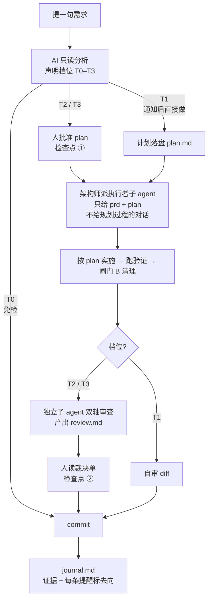

# 个人项目脚手架 —— 一份介绍

> 给第一次接触的人。读完你应该知道：它解决什么问题、怎么开始、一个任务走一遍长什么样、以及它不适合什么场景。
>
> 想直接动手：跳到 [快速开始](#快速开始)。

## 一句话

一条命令生成完整项目骨架，骨架里带**一套让 AI 按流程干活、并且能被机器检查的规则**。

它不是目录模板，是流程模板：目录、文档、角色提示词、闸门检查器、提交钩子，全都预置好并对齐。

## 它解决什么问题

和 AI 一起写代码，真正崩掉的地方通常不是模型不够强，而是这四件事：

| 症状 | 这里的对策 |
|---|---|
| 需求聊得很透，然后在聊天记录里蒸发了 | 任务目录 `tasks/<日期>-<简述>/` 存 `prd.md` / `plan.md` / `journal.md`。开一个新会话，读这三份就能接上 |
| AI 说「已完成」，但没有真的跑过 | 每个流程有**退出门槛**，不是步骤清单：修 bug 先要一条能对**这个** bug 变红的命令；提交前要真跑验证命令并贴输出 |
| 计划写一套、实现另一套 | 计划和实现**换人**：规划的人停在自己的计划上，派一个只拿到 `prd.md` + `plan.md` 的执行者去做；大改动的审查再换第三个上下文 |
| 上次踩过的坑这次再踩 | 坑进 `docs/pitfalls.md`，决策进 `docs/adr/`，术语进 `CONTEXT.md`，任务提醒必须标去向——都不留在聊天里 |

核心判断：**写下来的规则靠自觉，能跑起来的规则才靠得住。** 所以这里的规矩大多是命令，不是提醒。

## 快速开始

```powershell
# Windows
.\init.ps1 my-project-name

# Linux / macOS / WSL
bash init.sh my-project-name
```

生成完整骨架（文件清单见 README 的「生成的目录结构」）。`git init`、`core.quotepath=false`、`.githooks` 钩子都已经设好，不用重来。

唯一要记住的是：`core.hooksPath` 存在 `.git/config` 里，**不随 clone 走**——把项目 clone 到别的机器后要重跑一次：

```bash
git config core.hooksPath .githooks
```

项目名允许字母、数字、`.`、`_`、`-` 和中文；不接受空格、引号、shell 元字符、Windows 保留设备名，以及 `.` / `..` / `.git`。两个脚本的接受集完全一致。

### 生成出来的东西

**完整的目录树只有一份**：脚手架仓库 `README.md` 的「生成的目录结构」一节。这里只说它给了你什么（树不复制，复制出来的会漂）：

> 下表和本文其它地方出现的 `docs/…`、`skills/…`、`tasks/…` 都是**生成出来的那个项目里**的路径，不是本脚手架仓库的路径（本仓库里它们在 `templates/` 下）。

| 位置 | 作用 |
|---|---|
| `AGENTS.md` | 项目规范，AI 每轮必读 |
| `CONTEXT.md` | 领域词表，术语定案时填 |
| `docs/architecture.md` | 模块边界，提交时和实际模块目录双向比对 |
| `docs/commands.md` | 验证命令写死在文档里，不让 AI 猜 |
| `docs/pitfalls.md` | 踩过的坑：问题 / 现象 / 原因 / 解决 |
| `docs/adr/` | 决策记录 |
| `docs/agents/` | 两个角色的提示词（架构师 / 执行者）+ 任务分级 |
| `skills/` | 7 个流程：tdd、refactor、bug-fix、pre-review、receiving-review、research、self-audit |
| `tasks/README.md` | 任务目录怎么建、怎么归档、闸门升级后的存量违规怎么治 |
| `tasks/_template/` | prd、plan、journal、review、slice 五个模板 |
| `scripts/check-gates.sh` `.awk` | 闸门检查器 |
| `.githooks/pre-commit` | 提交时自动跑 `--staged` 模式 |
| `src/` | 空目录，你的代码 |

## 一个任务走一遍



### 档位：先量事实，再决定重量

档位由**两条轴**定，取更严的那个：

- **规模轴**：T0 单文件无行为变化 / T1 ≤3 文件行为局部 / T2 4 文件或跨模块或动公开接口 / T3 ≥5 文件或架构级或跨会话
- **类型轴**：加功能·重构 / bug 可复现 / bug 不可复现（最后一类**不看规模直接 T3**）

判据必须来自量出来的事实——文件数、`lsp references` 条数、有没有现成测试——不能来自「这个很简单」。

### 打断次数

| 档位 | 你要做的事 |
|---|---|
| T0 | 无 |
| T1 | 无。AI 发一行档位声明就继续做，你事后看 diff |
| T2 / T3 | 2 次：批准 `plan.md`、读 `review.md` 裁决单 |

另有 7 类**不可逆外部动作**随时会停：部署、花钱、删改数据、权限密钥、隐私外传、有副作用的第三方请求、申请新服务。这两类检查点不接受预先授权。

## 四道闸门

| 闸门 | 卡在哪 | 判据 | 谁来判 |
|---|---|---|---|
| 闸门 A | 修 bug，进根因假设前 | 一条**已实跑过**、能对**这个** bug 变红的命令 | 人确认；检查器验字段非空 |
| 规划 / 实施分离 | 计划批准后 | 实施者是独立子 agent，输入只有 `prd.md` + `plan.md` + 规范文件 | 机器验不了，靠流程与审查 |
| 闸门 B | 提交前 | 非 `.md` 文件里没有 `[DEBUG-` 残留，一次性脚本已删 | `check-gates.sh` 自动 |
| 规模底线 | 提交时 | 任务累计改 ≥4 个 `src/` 文件却没声明 T2/T3 | `check-gates.sh` 自动 |

`pre-commit` 钩子跑的是 `scripts/check-gates.sh --staged`，它检查的东西包括：

- `[DEBUG-` 残留
- `docs/architecture.md` 的模块表 vs 实际模块目录（双向）
- `plan.md`：档位 / 类型 / 目标 / 相关文件 / 验证命令 / 步骤表 / 确认清单
- `journal.md`：章节齐全、结束状态合法、验证结果有内容且不写「应该可以」、每条提醒都有去向
- 切片文件、`review.md`（T2/T3 必须存在且填全）
- **规模低报**：`src/` 下累计 ≥4 个文件却没有 T2/T3 声明

被拦下就补内容，不要 `--no-verify` 绕过。

## 几个不太直观、但关键的决定

| 决定 | 理由 |
|---|---|
| 规则做成可执行检查，不写成提示词 | 提示词靠自觉，钩子不会忘 |
| 计划和实现不在同一个上下文里 | 同一上下文里，实施者分不清「`plan.md` 写的」和「我记得当时为什么这么定」，计划就退化成事后合理化的文档 |
| 审查同样不给会话历史 | 写代码的人恰恰最看不见「谁还在按老接口用」 |
| 闸门只判**形式**，不判质量 | 「写了去向」机器能验，「写得对不对」不能。硬判质量，最后只会得到 `- [x] 已复盘` 这种勾选表演 |
| journal 的每条提醒必须有去向 | `tasks/_archive/` 在全量自查里被跳过，走查也不读历史 journal；没有去向的经验等于没写。去向四选一：`→ pitfalls` / `→ 任务分级阈值` / `→ skills/<名>` / `不沉淀` |
| 生成出来的项目能跟上脚手架演进 | `scaffold-update.sh` 逐文件三方合并：项目现状 × 生成时的旧模板 × 当前模板。保留本地改动，冲突写标记并留 `.ours/.base/.theirs` 快照 |

## 已有项目怎么跟上新版本

脚手架在演进，已生成的项目不用重新生成。在脚手架仓库根跑：

```bash
bash scripts/scaffold-update.sh /path/to/my-project            # 预览，不写盘
bash scripts/scaffold-update.sh /path/to/my-project --write    # 写盘（脚本不提交）
```

它只碰 `templates/` 里出现过的路径，`src/`、`tasks/<任务>/`、`.git/` 一概不动。文件分两类（`templates/.scaffold-kinds`）：

- **mechanism**（角色提示词、`skills/*`、闸门脚本、钩子、任务模板）：取模板版，本地改动备份到现场目录。这类文件本地改了，说明该往上反馈，不是该留一份分叉
- **content**（`docs/commands.md`、`docs/pitfalls.md`、`AGENTS.md` 正文等）：走三方合并；反复冲突的用 `--keep-local` / `--union` 裁决一次，之后不再打扰

基线从 `.scaffold-version` 记的提交来；老项目没有这个文件时，按内容在脚手架历史里比对，挑最像的版本并报一致率。

## 它不适用于

- **一次性脚本、几十行的实验**：整套流程比活本身大。
- **验证只能靠人眼、又建不出客观信号的项目**：流程的骨架是闸门，没有能变红的命令就没有闸门。视觉类项目可以进——截图像素基线也是客观信号。
- **想完全无人值守跑**：两个检查点是人工闸门，设计上不接受「以后都自动」。

也不必一次用全：只用 `tasks/` + 闸门也算用上了；角色分工和独立审查可以等任务真变大了加。

## 想试的话

1. 生成一个项目，`git init` + `git config core.hooksPath .githooks`，提交一次空骨架；
2. 让 AI 读 `WORKFLOW.md` 的 Phase 2，把技术栈、`docs/commands.md`、`docs/architecture.md` 填出来——这一步**不写业务代码**；
3. 找一个真需求走一遍 Phase 3，感受 T1 全程不打断、T2 那两次打断分别在审什么。

## 进一步阅读

| 想知道什么 | 看哪里 |
|---|---|
| 完整工作流程（Phase 1–4，每步的具体操作） | `WORKFLOW.md` |
| 档位怎么定、检查点在哪、独立审查谁做 | `docs/agents/任务分级.md`（生成后） |
| 闸门检查器覆盖了什么 | `scripts/check-gates.sh` 文件头 |
| 任务目录的用法与归档 | `tasks/README.md`（生成后） |
| 怎么改这个脚手架本身 | 仓库根的 `AGENTS.md` |
