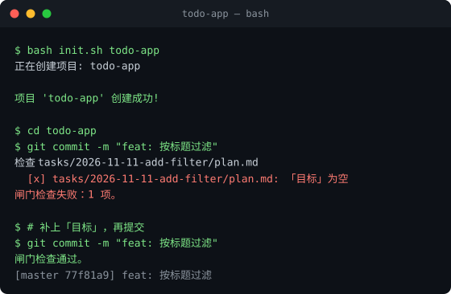

<div align="center">

# Vibecoding Workflow Scaffold

`scaffold` — one command generates a project skeleton that makes the AI work to a process, and
makes that process **machine-checkable**.

[](https://github.com/Blueety/scaffold/actions/workflows/check.yml)
[](LICENSE)


[简体中文](README.md) | **English**



<sub>Real terminal output: the plan's Goal field is empty, the commit is rejected; filled in, it passes.</sub>

</div>

If you work with an AI agent on real code, the failures that cost you are rarely "the model was
too weak". They are mundane: the AI skipped the plan and went straight to editing; it said
"done" without ever running the verification command; the plan and the implementation quietly
diverged; the same pitfall got rediscovered next week. Prompt templates and written conventions
rely on the model complying; here the rules are **executable checks** — a hook refuses the commit
instead of reminding the model once more.

This scaffold ships exactly that. What it generates is markdown and plain POSIX sh: project
rules and role prompts, seven process skills, five task templates, a gate checker
(`check-gates.sh` + `.awk`), and three git hooks. No language, framework, or dependency — you
bring the stack, the skeleton only fixes **how the AI is expected to work**.

It assumes you can spawn independent sub-agents (Claude Code, Codex CLI, or any orchestrator
with child sessions): the agent that plans and the agent that implements do not share context.
That is the load-bearing assumption of the whole design. Editors without that primitive can use
everything else, but plan/implementation separation is then on your discipline.

You do three things: generate the project, hand the agent its first instruction, and look at two
checkpoints — plan approval and commit. The rest is run by the agent per the project's own
`AGENTS.md`.

## Contents

- [What a gate actually blocks](#what-a-gate-actually-blocks)
- [When not to use this](#when-not-to-use-this)
- [Getting started](#getting-started)
- [First ten minutes](#first-ten-minutes)
- [What to say to the agent](#what-to-say-to-the-agent)
- [Three things that bite](#three-things-that-bite)
- [Updating a generated project](#updating-a-generated-project)
- [Other documents](#other-documents)

## What a gate actually blocks

Not a checklist — a refusal. The demo at the top is real terminal output: a commit whose
`plan.md` has an empty **Goal** field is rejected by the `pre-commit` hook, with the exact file
and field named; fill it in, commit again, it passes.

Other checks that run at the same moment: `journal.md` verification results must contain actual
content and may not say "should work"; every reminder in `journal.md` must name where it went
(`docs` / `adr` / `memory` / `journal`); `docs/architecture.md`'s module table must match the real
`src/` directories in both directions; `[DEBUG-` leftovers are refused; and a change touching
four or more files under `src/` without a declared size tier is refused as under-reporting.

Before any of that, the expensive gate is human: a bug fix is not allowed to start forming a
root-cause hypothesis until there is **one command that has actually gone red for this bug**.

## When not to use this

Stated up front, because installing it and discovering it does not fit is the worst outcome:

- **Everything except this README is Chinese.** This is the only English file: `INTRO.md`,
  `WORKFLOW.md`, `CONTRIBUTING.md`, all generated documents, task templates, skills, role prompts,
  and gate messages are Chinese. If your team cannot read Chinese, this is a translation project
  first — or not a fit at all.
- **One-off scripts and weekend experiments.** The process is bigger than the work.
- **Projects where correctness can only be judged by a human eye and no objective signal can be
  built.** The skeleton of the process is the gate; no command that can go red means no gate.
  Visual projects can still fit — an image pixel baseline is an objective signal.
- **Fully unattended runs.** Two checkpoints are human by design and cannot be pre-authorized.
- **No sub-agent primitive.** Without it you keep the task directory and the gates, but
  planning/implementation separation degrades into self-discipline.

You need not adopt all of it at once: `tasks/` plus the gates alone is already a real use; role
separation and independent review can come when tasks get large.

## Getting started

Requires `git`; on Windows PowerShell 5.1+, on Linux / macOS / WSL `bash` (3.2 is enough),
`awk`, `sed`. The generated project needs no Node, Python, or any runtime.

```bash
git clone https://github.com/Blueety/scaffold.git
cd scaffold
bash init.sh my-project-name
```

On Windows use `.\init.ps1 my-project-name`. Under the default execution policy (`Restricted`)
that line fails with "running scripts is disabled"; use this instead:

```powershell
powershell -ExecutionPolicy Bypass -File .\init.ps1 my-project-name
```

The script creates `my-project-name/` in the current directory, runs `git init`, sets
`core.quotepath=false`, and installs `.githooks/` as the hooks directory. There is no install
step; this is not an npm package.

Project names allow letters, digits, `.`, `_`, `-`, and non-ASCII characters (Chinese etc., must
be valid UTF-8). Names may not be `.` / `..` / `.git` (case-insensitive), may not start with `-`
or end with `.`, may not be Windows reserved device names (`CON` / `PRN` / `AUX` / `NUL` /
`COM1`–`COM9` / `LPT1`–`LPT9`), and may not contain spaces, quotes, path separators, control
characters, or shell metacharacters.

## First ten minutes

The shortest path to seeing the point:

1. `bash init.sh my-project-name && cd my-project-name` — the skeleton commits nothing; the first
   commit is yours.
2. Open `AGENTS.md` in the generated project. That is the whole process, in the form the agent
   reads every turn.
3. Ask for a small change in a **single** file and watch it declare tier `T0` and just do it. No
   plan, no interruption.
4. Ask for something touching 2–3 files; it must land `tasks/<date>-<slug>/plan.md` first, with a
   verification command.
5. Open the `plan.md` just created under `tasks/`, delete its Goal line, and `git commit` — the
   hook rejects it. That is the product.

## What to say to the agent

Inside the new project, hand it the process requirement together with the task:

```
Read AGENTS.md, create the task directory per tasks/README.md, write prd.md and plan.md
first. Don't touch code yet.
Task: <one sentence>
```

`T0` (one or two files, behavior unchanged) is done directly. `T1` and above must land a
`plan.md`, and only after you approve it does the agent spawn an implementation sub-agent. After
that you look at exactly two things: whether the verification commands in the plan can actually
run, and whether `journal.md`'s verification results are real output or "should work".

## Three things that bite

**Your code is not in `src/`.** The gate only counts modules and files under `src/` by default. If
your stack puts code in `app/`, `web/`, or `cmd/`, run the gate with `MODULE_ROOT=app`, or change
the default in `scripts/check-gates.sh`. Leave it alone and the module-table comparison and size
floor spin idly — the gate prints one `[!]` notice and does not block.

**Hooks die when you change machines.** `core.hooksPath` lives in `.git/config` and does not
travel with a clone. After cloning elsewhere, run `git config core.hooksPath .githooks` once, or
the hooks simply do not execute.

**The gate says "写法不对" (wrong format).** The machine reads only the `<!-- gate -->` header
block at the top of a file, and only `- **Label**:` with an ASCII colon; a full-width colon reads
as "empty". The templates are correct — copy them. If you really did write it wrong, the error
prints the shape it expects.

## Updating a generated project

After the scaffold changes, you do not regenerate:

```bash
bash scripts/scaffold-update.sh ../my-project-name           # preview, writes nothing
bash scripts/scaffold-update.sh ../my-project-name --write   # write to disk (no commit)
```

It touches only paths that exist in `templates/`; `src/` and `tasks/` are never modified.
Verdicts, conflict sites, and every switch are in [`UPDATE.md`](UPDATE.md).

## Other documents

| If you want to know | Read |
|---|---|
| The four-phase panorama, how one task runs end to end, the four gates, six key tradeoffs | [`INTRO.md`](INTRO.md) — start here on first contact (Chinese) |
| Step-by-step from requirement to commit (Phase 1–4) | [`WORKFLOW.md`](WORKFLOW.md) |
| The generated directory tree (the only copy; `check-tree.ps1` guards it) | [`CONTRIBUTING.md`](CONTRIBUTING.md) |
| Changing this scaffold itself: what to run, constraints, CI | [`CONTRIBUTING.md`](CONTRIBUTING.md) / [`AGENTS.md`](AGENTS.md) |
| Turning a web-chat discussion (GPT / Claude / Gemini) into a task, then handing it to a local agent | [`web-chat-templates/`](web-chat-templates/README.md) |

Questions, disagreements about the tradeoffs, or "we do this differently" — open an issue.

## License

MIT, see [`LICENSE`](LICENSE). Generated projects are yours; no attribution required.
