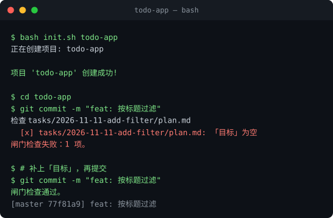

<div align="center">

# AI 工作流脚手架

`scaffold` —— 一条命令生成项目骨架，骨架里带一套让 AI 按流程干活、并且能被机器检查的规则。

[](https://github.com/Blueety/scaffold/actions/workflows/check.yml)
[](LICENSE)




</div>

生成出来的是 markdown 和纯 POSIX sh：项目规范与角色提示词、七个流程 skill、五份任务模板、闸门检查器（`check-gates.sh` + `.awk`）、三个 git 钩子。没有语言、框架和依赖，技术栈你自己装，骨架只约定「AI 按什么流程干活」。

它假设你能派独立子 agent（Claude Code、Codex CLI，或任何能开子会话的编排器）：写计划的人和实施的人不共享上下文，这是整套设计的支点。没有这个原语的编辑器也能用其余部分，但那一条只能靠人自觉。

你要做的只有三件事：生成项目、把第一句话交给 Agent、在「计划批准」和「提交」两处看一眼。其余由 Agent 按项目里的 `AGENTS.md` 执行。

> **English (short)** — One command scaffolds a project skeleton that encodes an **AI workflow with
> executable checks**: task state in git, a gate checker on `pre-commit` / `pre-merge-commit` / `pre-push`, and planning / implementation /
> review in *separate* agent contexts. Every core rule has either a machine check or an explicit
> "human judgment" label. Windows (PowerShell 5.1+) / Linux / macOS, stock bash 3.2, no runtime deps.
> Docs are Chinese; start with [`INTRO.md`](INTRO.md).
>
> ```bash
> bash init.sh my-project-name      # Windows: .\init.ps1 my-project-name
> ```

## 目录

- [开始](#开始)
- [对 Agent 说什么](#对-agent-说什么)
- [三件容易踩的事](#三件容易踩的事)
- [更新已生成的项目](#更新已生成的项目)
- [其余文档](#其余文档)

## 开始

需要 `git`；Windows 上有 PowerShell 5.1+，Linux / macOS / WSL 上有 `bash`（3.2 即可）、`awk`、`sed`。生成出来的项目不需要 Node、Python 或任何运行时。

```bash
git clone https://github.com/Blueety/scaffold.git
cd scaffold
bash init.sh my-project-name
```

Windows 用 `.\init.ps1 my-project-name`。默认执行策略（`Restricted`）下这条会报「禁止运行脚本」，换这行：

```powershell
powershell -ExecutionPolicy Bypass -File .\init.ps1 my-project-name
```

脚本在当前目录建 `my-project-name/`，同时 `git init`、写 `core.quotepath=false`、把 `.githooks/` 挂成钩子目录。没有 `install` 步骤，这不是 npm 包。

项目名允许字母、数字、`.`、`_`、`-` 和非 ASCII 字符（中文等，须是合法 UTF-8）；不能是 `.` / `..` / `.git`（不分大小写），不能以 `-` 开头或以 `.` 结尾，不能是 Windows 保留设备名（`CON` / `PRN` / `AUX` / `NUL` / `COM1`–`COM9` / `LPT1`–`LPT9`），也不能含空格、引号、路径分隔符、控制字符或 shell 元字符。

## 对 Agent 说什么

进到新项目里，把流程要求和需求一起交给它：

```
读 AGENTS.md，按 tasks/README.md 建任务目录，先写 prd.md 和 plan.md，别直接改代码。
需求：<一句话>
```

T0（改一两个文件、行为不变）可以直接做；T1 以上要落 `plan.md`，你批准之后它才会派实施子 agent。之后你只需要看两处：计划里的验证命令是不是真能跑，以及 `journal.md` 的验证结果是真实输出还是「应该可以」。

## 三件容易踩的事

**代码不在 `src/`。** 闸门默认只数 `src/` 下的模块和文件。技术栈把代码放在 `app/`、`web/`、`cmd/` 的话，用 `MODULE_ROOT=app` 跑闸门，或改 `scripts/check-gates.sh` 里那行默认值。不改的话模块表比对和规模底线会空转，闸门只打一条 `[!]` 提示，不拦。

**换了机器钩子失效。** `core.hooksPath` 写在 `.git/config` 里，不随 clone 走。clone 到别的机器后跑一次 `git config core.hooksPath .githooks`，否则钩子根本不执行。

**闸门说「写法不对」。** 机器只认文件第一行的 `<!-- gate -->` 头块，以及 `- **标签**:` 这种半角写法；全角冒号会被判成「没填」。模板是对的，照抄即可——真写歪了，报错会给出该写的样子。

## 更新已生成的项目

脚手架改了之后不用重新生成：

```bash
bash scripts/scaffold-update.sh ../my-project-name           # 预览，不写盘
bash scripts/scaffold-update.sh ../my-project-name --write   # 写盘（不提交）
```

只碰 `templates/` 里出现过的路径，`src/` 和 `tasks/` 一概不动。裁决、冲突现场、全部开关在 [`UPDATE.md`](UPDATE.md)。

## 其余文档

| 想知道什么 | 看哪里 |
|---|---|
| 一个任务怎么走、四道闸门、六条关键取舍 | [`INTRO.md`](INTRO.md)，第一次接触从这里开始 |
| 一个任务从需求到提交的逐步操作（Phase 1–4） | [`WORKFLOW.md`](WORKFLOW.md) |
| 生成出来的目录结构（唯一一份，`check-tree.ps1` 守着它） | [`CONTRIBUTING.md`](CONTRIBUTING.md) |
| 改这个脚手架本身：跑什么、约束、CI | [`CONTRIBUTING.md`](CONTRIBUTING.md) / [`AGENTS.md`](AGENTS.md) |
| 在网页 AI（GPT / Claude / Gemini）里把讨论整理成任务，再交接给本地 agent | [`web-chat-templates/`](web-chat-templates/README.md) |

## 许可

MIT，见 [`LICENSE`](LICENSE)。生成出来的项目属于你，没有署名要求。
